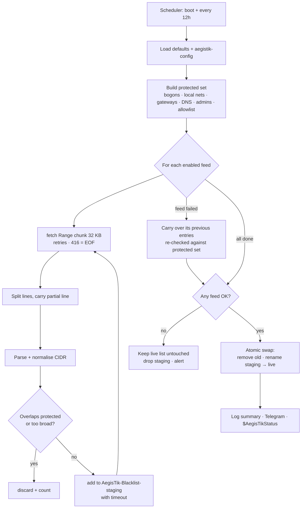

<div align="center">

# 🛡️ AegisTik

**Dynamic threat-intelligence blocker for MikroTik RouterOS v7**

Streams public blocklists (Spamhaus DROP, DShield, abuse.ch Feodo and more) into a firewall address-list. Bogons and your own networks are stripped out before anything is added, so a bad feed can't lock you out. It is built to run on small routers.

[](https://mikrotik.com/download)
[](LICENSE)
[](#-resource-usage--small-devices)
[](#-resource-usage--small-devices)
[](#-anti-lockout-sanitisation)
[](#-telegram-alerts)
[](https://github.com/Mapp25101/AegisTik/stargazers)

</div>

---

## Contents

- [Features](#-features)
- [Quick install](#-quick-install-1-line)
- [Recommended firewall rules](#-recommended-firewall-rules)
- [Configuration](#%EF%B8%8F-configuration)
- [Threat feeds](#-threat-feeds)
- [Anti-lockout sanitisation](#-anti-lockout-sanitisation)
- [Telegram alerts](#-telegram-alerts)
- [Resource usage & small devices](#-resource-usage--small-devices)
- [How it works](#-how-it-works)
- [Operating AegisTik](#-operating-aegistik)
- [Troubleshooting](#-troubleshooting)
- [Uninstall](#-uninstall)
- [Contributing](#-contributing)
- [License](#-license)

---

## ✨ Features

| | |
|---|---|
| **Modern RouterOS v7** | Uses `:onerror` for error handling, `:timestamp` for run timing, and normalises both date formats (`2026-10-16` on 7.10+ and the older `oct/16/2026`). |
| **Streaming, low RAM** | Feeds are downloaded in HTTP `Range` chunks (32 KB by default) straight into memory and parsed line by line. Peak memory is about one chunk, whatever the feed size, and no temporary files are written to flash. |
| **Anti-lockout** | RFC1918, CGNAT, loopback, link-local, multicast, reserved space, every local interface network, default gateways, DNS servers, logged-in admins, feed hosts and your allowlist are all **removed before** anything reaches the firewall. Overly broad prefixes (`/0`–`/7`) are rejected too. |
| **Zero-gap updates** | The new list is built in a staging list while the live list keeps blocking. It is then swapped in with two native bulk commands. |
| **Fail-safe** | If a feed is down, its previous entries are carried over. If every feed fails, the live list is left untouched. A feed that returns HTML or garbage instead of IPs counts as failed and doesn't wipe its entries. |
| **Automatic purging** | Every entry has a timeout (default `7d`), so RouterOS removes stale entries by itself if updates stop. Entries that drop out of a feed disappear on the next run. |
| **No config bloat** | Timed entries are dynamic. They never end up in `/export`, backups or the config database on flash. |
| **Telegram alerts** | Optional alert on failure (or a degraded run) and an optional silent summary on success. |
| **Upgrade-safe config** | The engine (`aegistik`) and your settings (`aegistik-config`) are separate scripts. Re-running the installer upgrades the engine and keeps your settings. |
| **Safe concurrency** | A single-instance lock stops overlapping runs. |

---

## 🚀 Quick install (1-line)

> **Requirements:** RouterOS **7.13 or newer**, working DNS and Internet access, and a CA trust store for HTTPS (see [Certificates](#certificates) below).

Paste this into a RouterOS terminal (WinBox → *New Terminal*, or SSH):

```routeros
/tool fetch url="https://raw.githubusercontent.com/Mapp25101/AegisTik/main/install.rsc" dst-path=aegistik-install.rsc check-certificate=yes-without-crl; /import file-name=aegistik-install.rsc; /file remove [find where name="aegistik-install.rsc"]
```

The installer:

1. checks that RouterOS is 7.13+;
2. installs (or upgrades) `/system script aegistik`, the engine;
3. creates `/system script aegistik-config` with sensible defaults, **only if it doesn't exist yet**;
4. creates `/system scheduler aegistik`, which runs at boot and every **12 h**;
5. starts the first run in the background.

**Installer options.** Set any of these globals *before* the one-liner:

```routeros
# refresh interval (default 12h, minimum 1h)
:global AegisTikInterval "6h"
# also add the recommended raw firewall rules at the top of the raw table
:global AegisTikAddRules "yes"
```

<details>
<summary><b>Router has no CA store and you can't add one</b> (insecure fallback)</summary>

```routeros
:global AegisTikInsecure "yes"; /tool fetch url="https://raw.githubusercontent.com/Mapp25101/AegisTik/main/install.rsc" dst-path=aegistik-install.rsc check-certificate=no; /import file-name=aegistik-install.rsc; /file remove [find where name="aegistik-install.rsc"]
```

This also requires `:set ($cfg->"checkCertificate") "no"` in `aegistik-config`. Downloads are then open to man-in-the-middle tampering, so treat it as a temporary measure.
</details>

### Certificates

AegisTik verifies HTTPS certificates by default (`check-certificate=yes-without-crl`). The router needs trusted root CAs for that:

- **RouterOS 7.19+** ships a built-in root store. Check `/certificate settings print` and make sure the built-in trust store (`builtin-trust-store`) is enabled for system services such as fetch.
- **Older versions, or a missing root:** import the Mozilla CA bundle once:

  ```routeros
  /tool fetch url="https://curl.se/ca/cacert.pem" dst-path=cacert.pem
  /certificate import file-name=cacert.pem passphrase=""
  /file remove [find where name="cacert.pem"]
  ```

### Manual install

Prefer copy-and-paste? Create two scripts in **System → Scripts**: `aegistik`, with the contents of [`aegistik.rsc`](aegistik.rsc), and `aegistik-config`, with [`aegistik-config.rsc`](aegistik-config.rsc). Give both the policies `ftp, read, write, policy, test`. Then add the scheduler:

```routeros
/system scheduler add name=aegistik start-time=startup interval=12h policy=ftp,read,write,policy,test on-event="/system script run aegistik"
```

---

## 🔥 Recommended firewall rules

AegisTik only maintains the address-list. **Blocking happens in your firewall.** For blocklists, the **raw** table is the best place: packets are dropped in `prerouting`, before connection tracking, which costs the least CPU.

### Option A: Raw table (recommended)

```routeros
/ip firewall raw
add chain=prerouting in-interface-list=WAN src-address-list=AegisTik-Blacklist action=drop comment="AegisTik: drop inbound from blacklist"
add chain=prerouting in-interface-list=LAN dst-address-list=AegisTik-Blacklist action=drop comment="AegisTik: drop outbound to blacklist"
```

- **Rule 1** drops all traffic *from* listed networks arriving on WAN, including scans, brute-force attempts and hijacked netblocks.
- **Rule 2** stops LAN hosts from talking *to* listed networks, which cuts botnet/C2 callbacks from infected devices. Spamhaus explicitly recommends blocking DROP in both directions.

> Rules must sit **above** any `accept` rules in the raw table. If the table already has rules, run `/ip firewall raw print` first and append `place-before=0` to each `add` command. Or use `:global AegisTikAddRules "yes"` with the installer, which places them at the top for you.

### Option B: Filter table (if you want per-rule counters or `reject`)

```routeros
/ip firewall filter
add chain=input in-interface-list=WAN src-address-list=AegisTik-Blacklist action=drop comment="AegisTik: drop input from blacklist"
add chain=forward in-interface-list=WAN src-address-list=AegisTik-Blacklist action=drop comment="AegisTik: drop forward from blacklist"
add chain=forward out-interface-list=WAN dst-address-list=AegisTik-Blacklist action=reject reject-with=icmp-admin-prohibited comment="AegisTik: reject outbound to blacklist"
```

Put them **before** the default `accept established,related` rule. Otherwise existing connections to blacklisted hosts keep flowing.

> The default MikroTik configuration defines the `WAN` and `LAN` interface lists. If you don't use them, replace `in-interface-list=WAN` with `in-interface=ether1` (your uplink), and so on.

**Optional: see what gets blocked.** Add `log=yes log-prefix="AegisTik"` to a rule for a few minutes. Don't leave logging on for raw drops on a busy link.

---

## ⚙️ Configuration

All settings live in `/system script aegistik-config` (WinBox → System → Scripts → `aegistik-config`). The installer never overwrites it. Any key you remove falls back to the engine default.

| Key | Default | Description |
|---|---|---|
| `listName` | `AegisTik-Blacklist` | Address-list that your firewall rules match. |
| `allowListName` | `AegisTik-Allowlist` | Address-list of networks that are **never** blocked. Manage it from WinBox. |
| `allowlist` | `""` | Extra never-block networks, comma separated: `"203.0.113.10,198.51.100.0/24"`. |
| `entryTimeout` | `7d` | Timeout on every entry, which acts as the auto-purge dead-man switch. Must be well above the scheduler interval (min `1h`). |
| `chunkSize` | `32000` | Bytes per HTTP Range request (4096–60000). |
| `maxChunks` | `128` | Maximum chunks per feed (size cap = `chunkSize × maxChunks`). |
| `maxEntries` | `60000` | Hard cap on the total number of entries. |
| `minFreeMemory` | `4194304` | Abort a feed if free RAM drops below this many bytes. |
| `minPrefixLen` | `8` | Reject prefixes broader than `/N`. |
| `fetchRetries` / `retryDelay` | `3` / `5s` | Retries per chunk. |
| `bootDelay` | `60s` | Extra wait when the router booted less than 5 minutes ago. |
| `checkCertificate` | `yes-without-crl` | `yes`, `yes-without-crl` or `no`. |
| `protectGateways` | `yes` | Never block default-route and DHCP-client gateways. |
| `protectDns` | `yes` | Never block configured and dynamic DNS servers. |
| `protectAdmins` | `yes` | Never block source IPs of logged-in admin sessions (`/user active`). |
| `protectFeedHosts` | `yes` | Never block the feed servers, GitHub raw or the Telegram API. |
| `telegramToken` / `telegramChatId` | `""` | Telegram bot credentials. Leave empty to disable alerts. |
| `notifyOnFailure` | `yes` | Alert when a run is `DEGRADED` or `FAILED`. |
| `notifyOnSuccess` | `no` | Send a silent summary after every successful run. |
| `feeds` | see below | Feed definitions. |

Example: tune a 32 MB device and enable Telegram:

```routeros
:set ($cfg->"chunkSize") 16000
:set ($cfg->"maxEntries") 15000
:set ($cfg->"telegramToken") "123456789:AAE-your-bot-token"
:set ($cfg->"telegramChatId") "-1001234567890"
```

---

## 📡 Threat feeds

| Name | Default | Format | Approx. size | Source |
|---|:---:|---|---|---|
| `spamhaus-drop` | ✅ | `cidr` | ~1.5k prefixes | [Spamhaus DROP](https://www.spamhaus.org/blocklists/do-not-route-or-peer/): hijacked and criminal netblocks (includes the former EDROP) |
| `dshield-top20` | ✅ | `dshield` | 20 × /24 | [DShield](https://www.dshield.org/): top attacking subnets |
| `feodo-c2` | ✅ | `cidr` | small | [abuse.ch Feodo Tracker](https://feodotracker.abuse.ch/): botnet C2 servers |
| `et-compromised` | ⬜ | `cidr` | ~1–2k | [Emerging Threats](https://rules.emergingthreats.net/blockrules/): compromised hosts |
| `cins-army` | ⬜ | `cidr` | ~15k | [CINS Army](https://cinsscore.com/): poor-reputation IPs |
| `ipsum-level3` | ⬜ | `cidr` | ~10–20k | [IPsum](https://github.com/stamparm/ipsum): IPs on 3 or more blocklists |
| `blocklist-de` | ⬜ | `cidr` | ~20–30k | [blocklist.de](https://www.blocklist.de/): fail2ban-reported attackers |
| `firehol-level1` | ⬜ | `cidr` | ~4–5k prefixes | [FireHOL Level 1](https://iplists.firehol.org/): aggregate that **contains bogons**, which shows off the sanitiser |

Sizes change daily. Turn a feed on by setting `"enabled"="yes"` in `aegistik-config`.

**Adding your own feed:** any plain-text list with one IPv4 address or CIDR per line works. Comments starting with `#`, `;` or `//` and trailing text after a space, tab, `;` or `,` are ignored:

```routeros
:set ($feeds->"my-feed") {"enabled"="yes"; "format"="cidr"; "url"="https://example.com/blocklist.txt"}
```

> Large feeds must be served by a web server that honours HTTP `Range` requests, which nearly every static host does. Files under ~63 KB work even without `Range` support.

> Check each feed's terms of use before commercial deployment. AegisTik only downloads what you enable.

---

## 🧯 Anti-lockout sanitisation

Before an entry is added, it's normalised (host bits cleared) and checked for **overlap** against a protected set. If the entry contains or sits inside any protected network, it's dropped.

| Always protected | |
|---|---|
| `0.0.0.0/8` | "this network" |
| `10.0.0.0/8`, `172.16.0.0/12`, `192.168.0.0/16` | RFC1918 private |
| `100.64.0.0/10` | CGNAT (RFC 6598) |
| `127.0.0.0/8` | loopback |
| `169.254.0.0/16` | link-local |
| `192.0.0.0/24`, `192.0.2.0/24`, `198.51.100.0/24`, `203.0.113.0/24` | IETF / TEST-NET |
| `198.18.0.0/15` | benchmarking |
| `224.0.0.0/4` | multicast |
| `240.0.0.0/4` | reserved + broadcast |
| every `/ip address` network | LAN, WAN, VPN and PPPoE peer, re-read every run |

| Dynamically protected (configurable) | |
|---|---|
| default-route and DHCP-client gateways | `protectGateways` |
| configured and dynamic DNS servers | `protectDns` |
| source IPs of logged-in admins | `protectAdmins` |
| feed hosts, `raw.githubusercontent.com`, `api.telegram.org` | `protectFeedHosts` |
| `AegisTik-Allowlist` address-list and the `allowlist` setting | always |

Also rejected: malformed lines, non-canonical notations (`010.1.1.1`, `1.2.3`), IPv6 lines (skipped), and prefixes shorter than `minPrefixLen` (default `/8`).

Carried-over entries from a failed feed are **re-checked** against the current protected set. If your ISP hands you a new WAN address inside an old blacklisted range, that entry won't survive the next run.

Never block your own management address: add it to the allowlist.

```routeros
/ip firewall address-list add list=AegisTik-Allowlist address=198.51.100.25 comment="office static IP"
```

---

## 📲 Telegram alerts

1. Talk to [@BotFather](https://t.me/BotFather), create a bot and copy the token.
2. Send your bot any message (or add it to a group).
3. Open `https://api.telegram.org/bot<TOKEN>/getUpdates` in a browser and copy `chat.id`.
4. Put both into `aegistik-config` and run `/system script run aegistik`.

Example alert:

```
⚠ AegisTik 1.0.0 @ hEX-Office
2026-10-16 03:00:12
Status: DEGRADED (2 ok, 1 failed)
AegisTik-Blacklist: 1489 entries
dshield-top20: +20 dup 0 protected 0 bad 1 too-wide 0
feodo-c2: FAILED (fetch status failed)
spamhaus-drop: +1462 dup 0 protected 3 bad 0 too-wide 0
carried over from failed feeds: 7
Duration: 00:00:41.528
Last successful update: 12:00:03 ago
```

Success summaries are sent with `disable_notification` so they arrive silently.

---

## 🪶 Resource usage & small devices

AegisTik is written for devices like the **hAP lite** (32 MB RAM / 16 MB flash) and the **hEX** (256 MB RAM):

- **Chunked streaming.** `/tool fetch output=user` keeps at most 64,512 bytes and silently truncates anything longer. AegisTik requests `Range: bytes=N-M` slices (default 32 KB) and carries the partial last line of each slice into the next one. A 2 MB feed therefore uses about the same RAM as a 20 KB feed.
- **No files.** Nothing is written to flash during a run, so there's no NAND wear and no risk of filling the 16 MB flash on a hAP lite.
- **Dynamic entries.** Timed address-list entries live in RAM only and stay out of the config database.
- **Guards.** `minFreeMemory` aborts a feed before RAM gets tight. `maxEntries` caps the list size. `maxChunks` caps the feed size.
- **Staging overhead.** During the swap, old and new lists coexist briefly, so budget for **twice** the list size at peak.

Suggested profiles:

| Device | RAM | `chunkSize` | `maxEntries` | Feeds |
|---|---|---|---|---|
| hAP lite / hAP ac lite | 32–64 MB | `16000` | `15000` | defaults |
| hEX / hAP ac² | 128–256 MB | `32000` | `60000` | defaults + ET + CINS |
| RB5009 / CCR | 1 GB+ | `60000` | `200000` | anything |

---

## 🔍 How it works



Each entry is tagged `comment=AegisTik:<feed>`, which allows per-feed carry-over and keeps any manual entries you add to the list (with a different comment) safe from the swap.

---

## 🧰 Operating AegisTik

```routeros
# Run now
/system script run aegistik

# Follow the log
/log print follow where message~"AegisTik"

# Last run summary (kept in RAM until reboot)
:global AegisTikStatus; :put $AegisTikStatus

# Count entries, total and per feed
/ip firewall address-list print count-only where list=AegisTik-Blacklist
/ip firewall address-list print count-only where list=AegisTik-Blacklist comment="AegisTik:spamhaus-drop"

# Is an address listed?
/ip firewall address-list print where list=AegisTik-Blacklist address~"^203\\.0\\.113\\."

# Upgrade the engine (config is preserved): just re-run the one-line installer.
```

---

## 🩺 Troubleshooting

| Symptom | Cause / fix |
|---|---|
| `syntax error` when the script runs | RouterOS older than 7.13 (no `:onerror`). Upgrade RouterOS. |
| `fetch status failed` / SSL errors | No CA store. See [Certificates](#certificates). Also check that `/ip dns` resolves. |
| `server ignores HTTP Range and the file exceeds 63 KiB` | The feed host doesn't support Range requests. Use a mirror or a smaller list. |
| `no valid IPv4 entries found` | The feed returned an HTML page, a captcha or a new format. Check the URL in a browser. |
| `free memory below …` | Lower `chunkSize` and `maxEntries`, or disable large feeds. |
| `feed larger than maxChunks x chunkSize` | Raise `maxChunks`, or this feed is too big for the device. |
| `another run is still in progress` | A previous run is still working (slow device or large feeds). Lengthen the interval. |
| Blacklist empty after reboot | Expected: entries are dynamic. The `startup` scheduler run refills it after `bootDelay`. |
| My own IP got blocked | It can't via the feed path, but check other firewall rules. Add the address to `AegisTik-Allowlist` anyway. |

---

## 🗑️ Uninstall

```routeros
/system scheduler remove [find where name="aegistik"]
/system script remove [find where name~"^aegistik"]
/ip firewall raw remove [find where comment~"^AegisTik"]
/ip firewall filter remove [find where comment~"^AegisTik"]
/ip firewall address-list remove [find where list~"^AegisTik-Blacklist"]
/system script environment remove [find where name~"^AegisTik"]
```

The `AegisTik-Allowlist` list is left in place. Remove it manually if you no longer need it.

---

## 🤝 Contributing

Issues and pull requests are welcome, especially:

- feed definitions and parsers for additional formats;
- test reports for specific hardware and RouterOS versions (please include `/system resource print` output and run times);
- IPv6 support (`/ipv6 firewall address-list`) is on the roadmap.

Please keep the engine under ~60 KB. The installer pulls it with a single `fetch output=user`, which is limited to 64,512 bytes.

---

## 📄 License

Released under the [MIT License](LICENSE).

AegisTik isn't affiliated with or endorsed by MikroTik, Spamhaus, SANS/DShield, abuse.ch or any other feed provider. All trademarks belong to their owners. Blocklists can contain false positives, so use them at your own risk.
